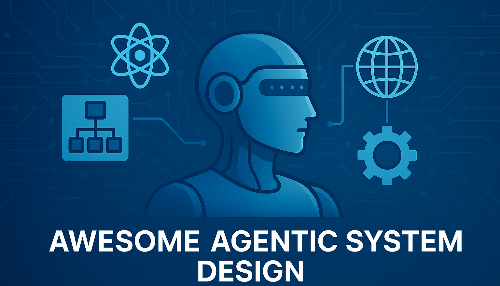
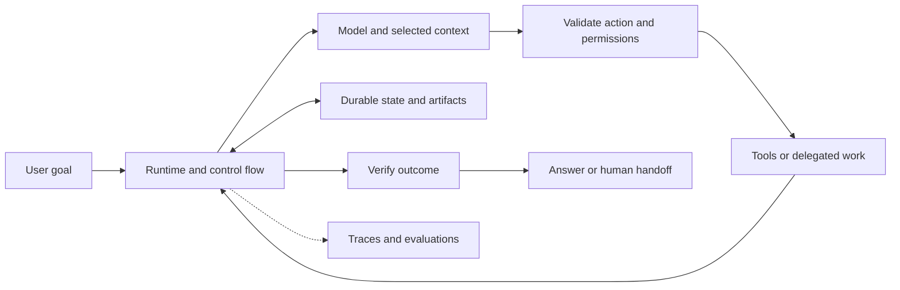

  

# Awesome Agentic System Design

A curated learning and reference hub for **designing, evaluating, and operating AI agents**. Coverage includes fundamentals, architectural tradeoffs, recent research, and system design interviews.

## Learning paths

| Focus | Path | Coverage |
| --- | --- | --- |
| Fundamentals | [Learning roadmap](docs/learning-roadmap.md) → [architecture](docs/architecture.md) → [context and memory](docs/context-and-memory.md) | Agent loops, state, tools, and information management |
| Production systems | [Tools and protocols](docs/tools-and-protocols.md) → [evaluation](docs/evaluation.md) → [production and safety](docs/production-and-safety.md) | Recovery, permissions, budgets, and quality measurement |
| Interview preparation | [Interview guide](docs/interview-preparation.md) → [worked case studies](docs/case-studies.md) | Design questions, quantitative reasoning, and architectural tradeoffs |
| Recent developments | [Updates](UPDATES.md) → [research papers](resources/papers.md) | Releases, migration notes, and research findings |
| Implementation tools | [Frameworks and platforms](resources/frameworks.md) | Control flow, deployment models, and operational capabilities |

## What is agentic system design?

An agentic system uses a model to choose actions, invoke tools, observe results, and adapt its next steps toward a goal. A **workflow** defines the control flow in code; an **agent loop** delegates some of those decisions to a model. Most useful applications combine both.

System design covers the software around that loop: state, context, permissions, execution, evaluation, observability, and failure recovery. More agents, tools, or autonomy are design choices to justify with evidence.

## Core topics

1. [Architecture and orchestration](docs/architecture.md) — workflows, single agents, routing, parallel work, delegation, and verification.
2. [Context, retrieval, and memory](docs/context-and-memory.md) — context budgets, agentic RAG, compaction, persistent memory, and provenance.
3. [Tools, skills, and protocols](docs/tools-and-protocols.md) — tool contracts, MCP, A2A, Agent Skills, and interoperability boundaries.
4. [Evaluation and benchmarks](docs/evaluation.md) — task success, repeated trials, trajectory analysis, graders, and benchmark selection.
5. [Production, reliability, and safety](docs/production-and-safety.md) — durable execution, isolation, approvals, injection resistance, latency, and cost.
6. [Interview preparation](docs/interview-preparation.md) — discussion topics, tradeoff questions, quantitative reasoning, and a self-assessment rubric.
7. [Design case studies](docs/case-studies.md) — support, research, coding, and incident response agents.

## Foundational resources

Introductory guides and research covering core system design concepts.

| Resource | Topic |
| --- | --- |
| [Building effective agents — Anthropic](https://www.anthropic.com/engineering/building-effective-agents) | Workflows and agent design patterns. |
| [Agents — Google / Kaggle](https://www.kaggle.com/whitepaper-agents) | Models, tools, and orchestration. |
| [ReAct](https://arxiv.org/abs/2210.03629) | Interleaved reasoning and action. |
| [Effective context engineering — Anthropic](https://www.anthropic.com/engineering/effective-context-engineering-for-ai-agents) | Context selection and maintenance. |
| [Demystifying evals for AI agents — Anthropic](https://www.anthropic.com/engineering/demystifying-evals-for-ai-agents) | Agent evaluation methodology. |
| [Towards a Science of AI Agent Reliability](https://arxiv.org/abs/2602.16666) | Consistency, robustness, predictability, and safety. |

## Resource catalogs

- [Guides, books, and engineering reports](resources/guides.md)
- [Research papers by design question](resources/papers.md)
- [Frameworks, SDKs, platforms, and application examples](resources/frameworks.md)
- [Benchmarks and evaluation references](docs/evaluation.md#benchmark-selection)
- [Recent developments and migration notes](UPDATES.md)

## Contributing

Suggest resources that teach a design decision, provide reproducible evidence, or document a meaningful change. Include a primary source and a short explanation of its design relevance. See [the contribution guide](CONTRIBUTING.md) for selection criteria and the review process.

This repository's original content is available under the [MIT license](LICENSE). Linked resources retain their respective licenses.
