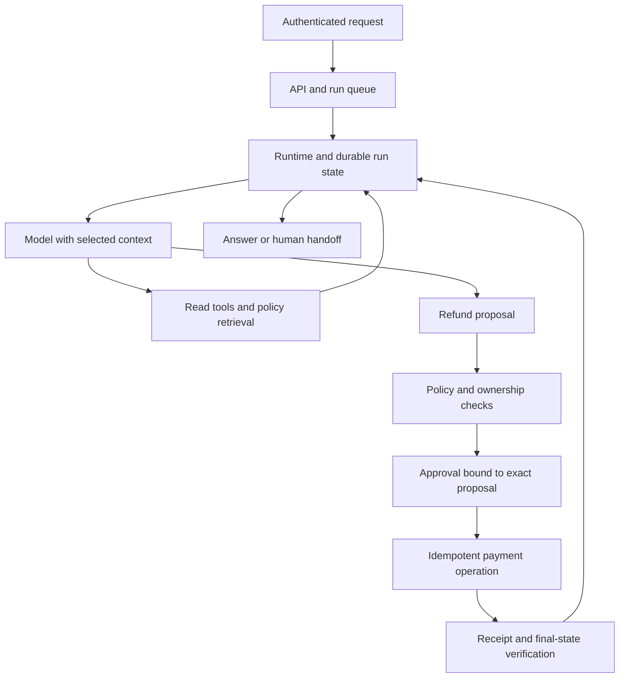

# Worked system design cases

[Home](../README.md) · [Interview guide](interview-preparation.md) · [Production and safety](production-and-safety.md)

These worked designs illustrate architectural choices across four applications. Their constraints and thresholds are assumptions to debate. Each begins with a small baseline and identifies evidence that would justify greater complexity.

## 1. Customer support and refunds

**Goal:** answer order questions and issue an eligible refund only after the required approval. Assume authenticated customers, multiple tenants, 100,000 tasks/day, and a 15-second target for ordinary read-only answers. Approval-based tasks can continue asynchronously. Exclude policy negotiation and unsupported payment providers from the first version.

**Control flow:** start with one tool-using agent inside a fixed business workflow. The agent resolves the order reference, retrieves policy, and prepares an explanation or proposal. Deterministic code checks eligibility, ownership, currency, amount limits, and prior refunds. Execution occurs through a separate write capability after approval.

**Data and interfaces:** use an order service as the source of truth, a versioned policy index for explanations, and a durable run store. Read tools return timestamps and source IDs. Store the proposal, policy version, approval, and payment operation ID in the action ledger. Never infer authority from a customer ID supplied by the model.

**Failure walkthrough:** the payment provider commits a refund but the worker times out. The next worker loads the original operation ID and looks up its status. It records the original receipt rather than creating another refund. If status cannot be established, it leaves the task in reconciliation and routes it to an operator. It does not tell the customer the refund succeeded without evidence.

**Evaluation:** seed the order database, execute a task, then inspect final state. Check the correct account, amount, approval, and number of refunds. Include duplicate requests, partial refunds, stale policies, cross-tenant references, hostile retrieved text, and worker crashes. An example release gate is no unauthorized writes in the test suite plus a pre-agreed success and latency target; monitor production for violations and add new failure cases to the suite.

**Scale and tradeoff:** queue background work and enforce per-tenant concurrency. The [interview estimates](interview-preparation.md#quantitative-reasoning) imply about 150 active tasks under their illustrative peak assumptions. A fixed FAQ/retrieval workflow is cheaper for common questions. Add routing or specialists only if category-level evaluations show a useful gain.

## 2. Research assistant with citations

**Goal:** produce a cited report answering a specific research question using permitted internal documents and public sources. Assume a five-minute deadline and a fixed research budget. The user can revise the scope; the agent cannot publish externally.

**Baseline:** clarify ambiguous scope, create a short coverage plan, retrieve sources, maintain an evidence table, draft, then verify claims. Start with one agent. Introduce parallel researchers only for independent subquestions, with separate budgets and one synthesis owner.

**State:** save the question, source URL/document ID, retrieval time, document version, relevant excerpt, supported claim, and conflicting evidence. Restrict internal retrieval by the user's actual permissions. Keep public-source content from becoming execution instructions.

**Failure walkthrough:** two sources disagree and one is outdated. The verifier checks dates and source authority, records the disagreement, and either resolves it with new evidence or describes the uncertainty. A lost worker resumes from the evidence table. Reaching the deadline yields a report with explicit coverage gaps.

**Evaluation:** grade coverage against a rubric and verify that citations support their associated claims. Measure unsupported claims, source diversity where relevant, time, and cost. Add cases where no reliable answer exists; abstention can be correct.

**Tradeoff:** parallel research can expand coverage but duplicate searches and introduce inconsistent assumptions. Compare against the single-agent baseline with the same total budget. More citations alone are not evidence of a better report.

## 3. Coding agent for issue resolution

**Goal:** turn a repository issue into a patch with test evidence for human review. Assume a 20-minute budget, an isolated checkout, and no authority to merge, deploy, or access production secrets.

**Baseline:** inspect repository instructions and relevant code, reproduce the issue, edit, run appropriate checks, and produce a diff with an explanation. Use a runtime that saves task progress and artifacts across context windows. A deterministic harness owns process limits and permission enforcement.

**State:** pin the base commit, record modified files, test commands and results, dependency versions, and unresolved failures. Isolate filesystem writes and network access. Tests execute untrusted repository code, so test execution belongs inside the sandbox too.

**Failure walkthrough:** the worker crashes after editing but before saving its summary. On resumption, inspect the checkout and recorded commands, rerun the relevant verification, and reconstruct progress from artifacts. Preserve unrelated user changes. A passing newly written test alone does not establish correctness; check the original failure and existing behavior.

**Evaluation:** use executable issue-specific checks and regression tests, then review the diff for scope and maintainability. Inspect unwanted changes to tests, configuration, or permissions. [SWE-bench Verified](https://www.swebench.com/verified) provides issue-resolution tasks; [LoopsBench](https://arxiv.org/abs/2608.00267) adds a useful perspective on long-running dependencies and regressions.

**Tradeoff:** independent review can catch errors but adds cost and may share the generator's blind spots. Parallel editing needs separate ownership or workspaces and an explicit integration step. Expand the harness only after measuring where the baseline loses progress or correctness.

## 4. Incident response assistant

**Goal:** shorten diagnosis and prepare a remediation proposal. Assume read access to selected telemetry and runbooks, a two-minute initial diagnosis target, and operator approval for any production change.

**Baseline:** a fixed workflow gathers incident metadata and recent changes. An agent with query and execution limits queries relevant telemetry, ranks hypotheses, and proposes a runbook action with expected effects and rollback steps. Keep execution under an existing operations control system.

**State:** preserve query time ranges, service/environment IDs, evidence, hypotheses, proposed parameters, approvals, and execution receipts. Separate current facts from inferred causes. Telemetry can contain attacker-controlled strings; it must not define commands or destinations by itself.

**Failure walkthrough:** an approved restart is about to execute after another operator already recovered the service. Revalidate current state and proposal preconditions; cancel or request a revised decision rather than execute stale remediation. If telemetry is unavailable, report the gap and avoid inventing a diagnosis.

**Evaluation:** replay historical incidents in an isolated environment, measure diagnostic usefulness and time, and check inappropriate actions and stale approvals. Compare with retrieval of the relevant runbook without an autonomous diagnostic loop.

**Tradeoff:** parallel diagnostic agents can investigate independent services, but need shared incident identifiers, query budgets, and a single owner for remediation. Optimize for reliable assistance to the operator.
